# 👋 Hola, soy Milton (megadato82)

Soy **Frontend Developer** con experiencia en **React, JS, CSS3, Three.js y Canvas y aprendiendo Next.js**, actualmente ampliando mis conocimientos en **Mesas de gestion con modelos y agentes IA**.  
Me apasiona crear interfaces dinámicas, visualizaciones interactivas y experiencias de usuario fluidas, combinando diseño y funcionalidad y lo mas importante: comprender el consumo del usuario.  

🎓 Egresado de la Maestría en **Diseño de Interfaces Web** en la Universidad Internacional de La Rioja (España).  
💼 Desarrollador en **Liber Salus**, donde construyo recursos digitales para la salud en México.  

---

### 🚀 Tecnologías principales
- Frontend: React, Vue, Zustand, Recharts, Next.js  
- Estilos y animaciones: CSS3, CanvasRenderingContext2D, Three.js  
- Visualización: SVG dinámico, gráficos interactivos  
- Modelos, skills, entornos agentes AI  

---

### 📌 Algunos de mis proyectos..

### 🦵 Catálogo de gestos en modelo 3D

Mi primer proyecto en Next.js. Un catalogo de animaciones para modelos 3D usando los recursos de Mixamo y @react-three/drei.

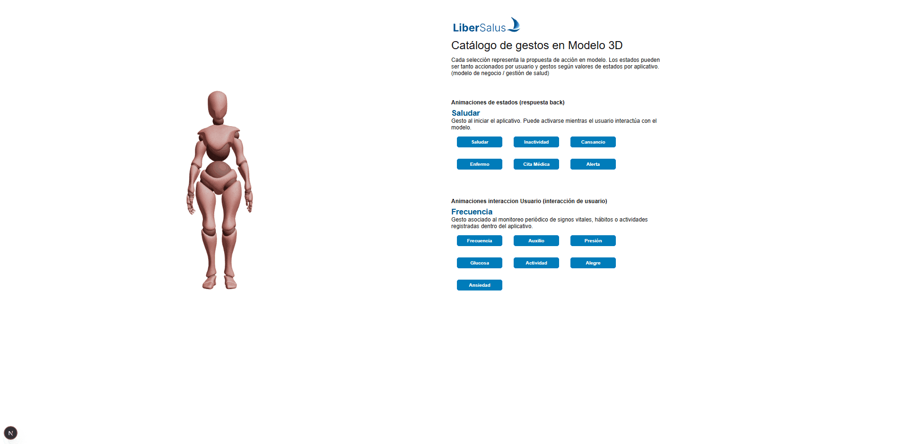

### 🗺️ Maper

Un mapeador que te permite filtrar lugares de tu interes sin necesidad de compartir ubicación con terceros. Puedes filtrar por categorias y configurar el radio de busqueda.

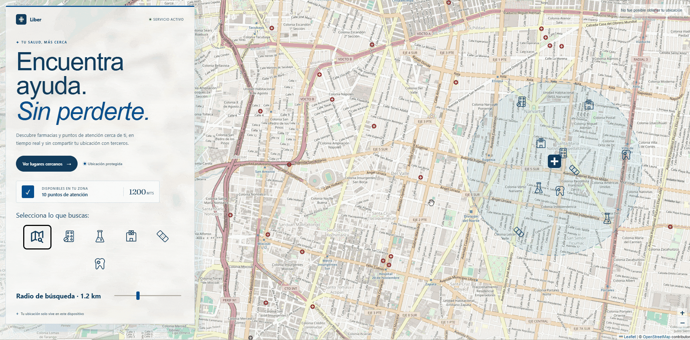

### 🖥️ Panel de desarrollo LiberSalus

Un panel para documentar desarrollar, probar y testear componentes, módulos y consumos de servicios, antes de producción. Herramienda indispensable de desarrollo FrontEnd.  

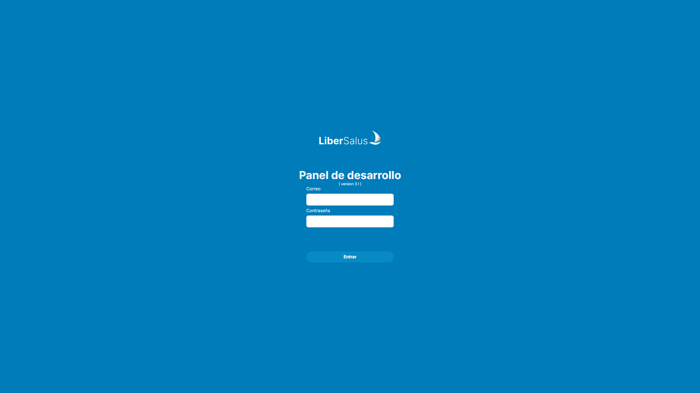

### ⚛️ React a tu ritmo
Pequeños pasos. Grandes interfaces. Un curso introductorio en **React + Vite + JavaScript** con **8 módulos y 16 lecciones**, ejemplos interactivos, ejercicios guiados y un proyecto final.

[Explorar el repositorio y el curso →](https://github.com/megadatogit/CursoReact)

### 🤖 Asis asistente virtual
Una forma que escucha, piensa y responde contigo 
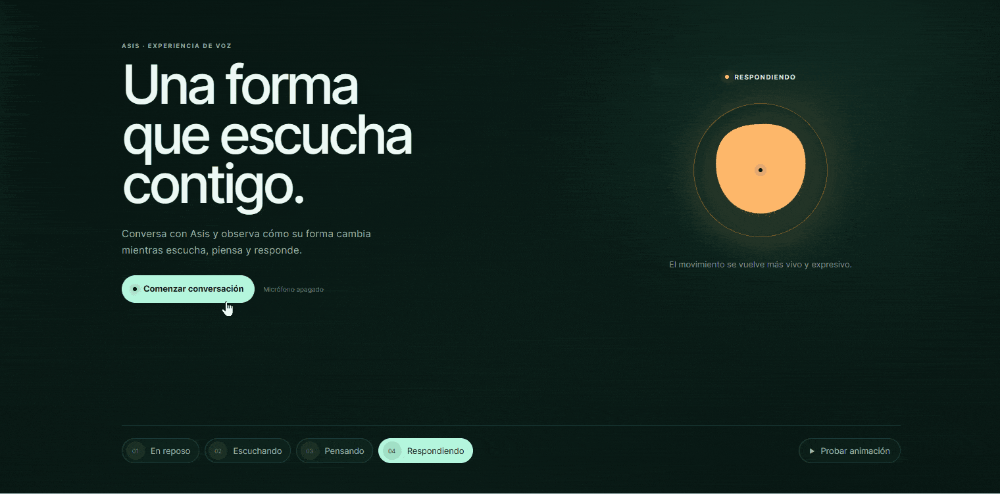

### 🫧 Página Abstract
Elementos y composiciones de transiciones en CSS.
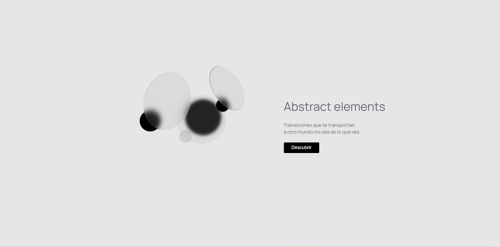

### 🗂️ Tablero Kanban
Aplicación en **React** con drag‑and‑drop y gestión visual de tareas.
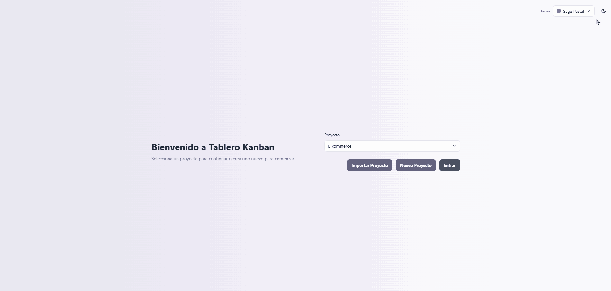

### 🌐 Landing LiberSalus
Landing page responsiva en **Vue + CSS3**, optimizada para conversión y accesibilidad.
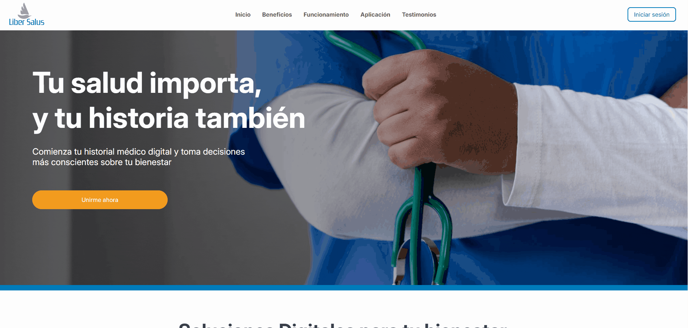

### 🎴 Tarjetas en React
Componente modular en **React** con estilos dinámicos y renderizado condicional.
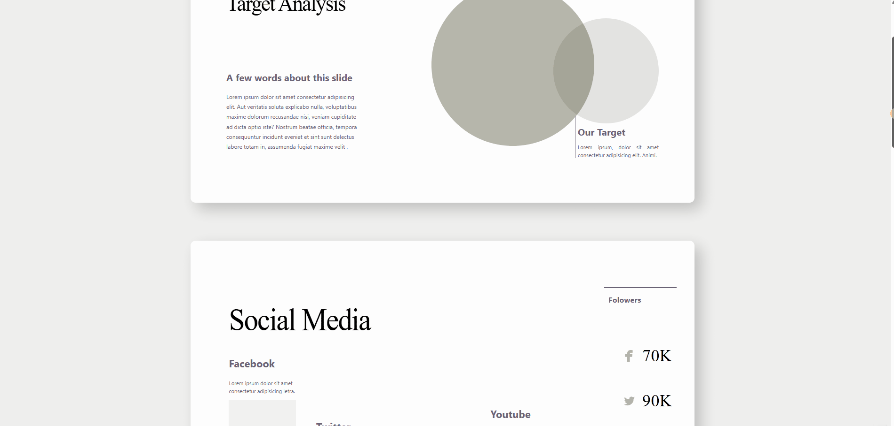

### 🌍 Transición Planet
Animación 3D con **Three.js**, explorando transiciones y renderizado interactivo.

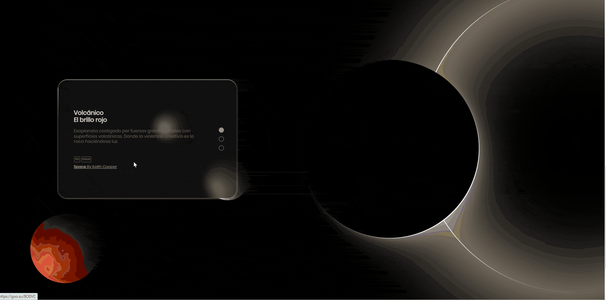

### 📊 EDR México (INEGI)
Dashboard interactivo con **SVG y CSS**, diseñado para visualización de datos.
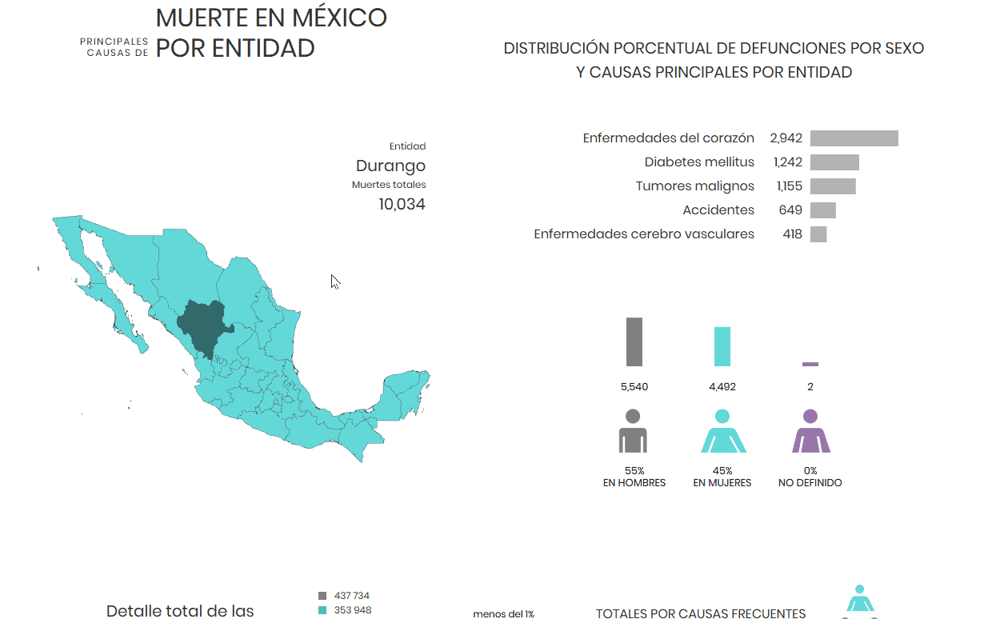

### 🔐 Dash Salud Personal (REGISTRO/INICIO)
Sistema de registro/login con **React + API**, enfocado en seguridad y usabilidad.
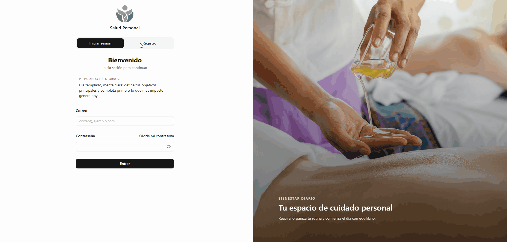

### 🩺 Monitoreo Salud
Visualización en **SVG y modelo 3D (Three.js)** para seguimiento de indicadores de salud.
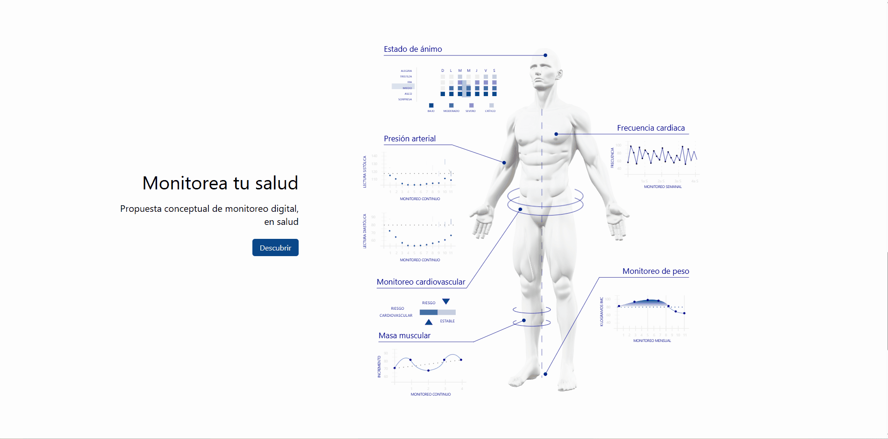

### 🖼️ Galería Responsiva con Transiciones
Galería de imágenes construida en **HTML + CSS**, adaptada a distintos tamaños de pantalla.  
Incluye **transiciones suaves** al cambiar la visualización, ofreciendo una experiencia fluida y atractiva para el usuario.
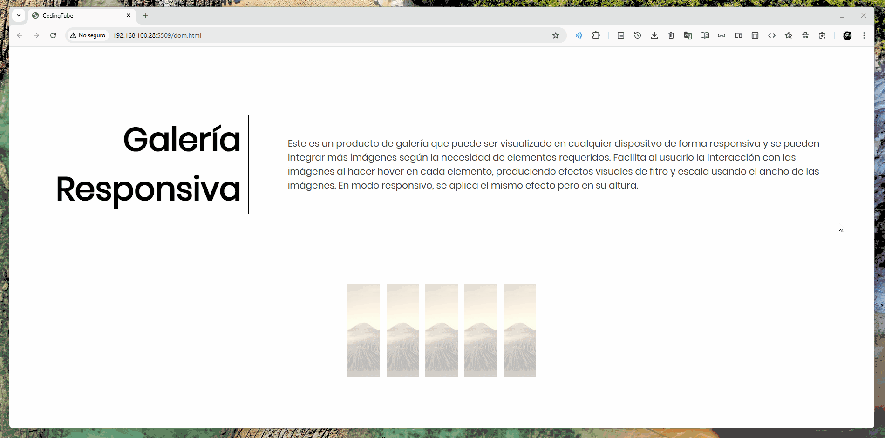
